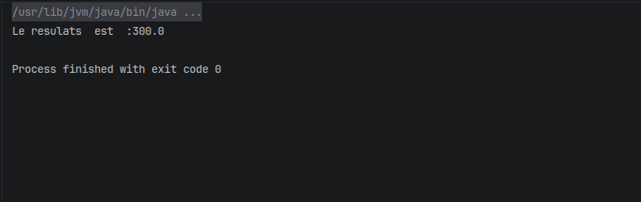

# TP2 : Spring IoC et injection de dependances

Dans ce TP, nous avons utilise les annotations Spring pour gerer les objets et injecter les dependances. Les classes `DaoImpl`, `DaoImpl2` et `MetierImpl` sont declarees avec `@Component`. La classe `Presentation2` utilise `@Configuration` et `@ComponentScan` pour configurer Spring et trouver les beans dans les packages `dao` et `metier`.

Dans `MetierImpl`, `@Autowired` permet a Spring d'injecter une implementation de `IDao`. Comme nous avons deux implementations, nous utilisons `@Qualifier` pour choisir celle a utiliser.

## Premiere execution : DaoImpl

Avec `@Qualifier("dao")`, Spring injecte `DaoImpl`. Sa methode `getValue()` retourne `100.0`. La methode `calcul()` multiplie cette valeur par 2, donc le resultat est `200.0`.

## Deuxieme execution : DaoImpl2

Nous avons ensuite change le qualifier en `@Qualifier("dao2")` pour injecter `DaoImpl2`. Cette implementation retourne `150.0`, donc le resultat devient `300.0`.

Le calcul reste le meme. Nous avons seulement change le qualifier pour choisir une autre implementation de `IDao`.
